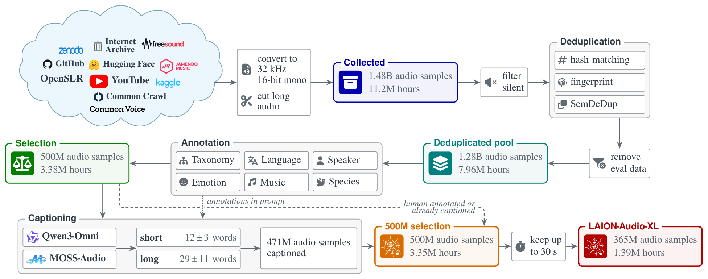

# LAION-Audio-XL

**A Web-Scale Corpus and Scaling Studies for Contrastive Language-Audio Pretraining**

[Project page](https://projects.laion.ai/clap2) · [Models](https://huggingface.co/laion/clap2-medium-audioxl-s1B) ·
[Dataset](https://huggingface.co/datasets/laion/laion-audio-xl)

LAION-Audio-XL is a corpus of 365M audio-text pairs (1.38M hours), selected from 1.48B audio samples of academic
datasets, internet datasets, web collections, Common Crawl and YouTube. CLAP2 are contrastive audio-text models in five
sizes (27M to 340M parameters) trained on it. This repository holds the data pipeline, the training and evaluation
recipes, and the experiments.

## Use the models

```python
# pip install "open_clip_torch[audio] @ git+https://github.com/mlfoundations/open_clip@refs/pull/1230/head"
import torch, open_clip as oc, soundfile as sf
hub = "hf-hub:laion/clap2-medium-audioxl-s1B"   # sizes: xxs, xs, small, medium, large
m, prep = oc.create_model_from_pretrained(hub)
w, sr = sf.read("dog.wav", dtype="float32")
x = prep(m.audio.cfg.audio_seq_len)((torch.from_numpy(w.T), sr))
a = m.encode_audio({k: v[None] for k, v in x.items()})
t = m.encode_text(oc.get_tokenizer(hub)(["a dog"]))
print(torch.cosine_similarity(a, t))
```

## Get the data

```python
from datasets import load_dataset
ds = load_dataset("laion/laion-audio-xl", streaming=True)   # configs: open (default), sharealike, noncommercial
```

Clips that cannot be redistributed are in the gated links repository `laion/laion-audio-xl-links`;
`0_download/web_youtube.py` and `0_download/web_links.py` stream its rows and download and cut the clips into
WebDataset tars, one folder per source dataset, ready as input `IN` of the pipeline.

## Pipeline

<picture>
  <source media="(prefers-color-scheme: dark)" srcset="docs/assets/pipeline_dark.png">
  
</picture>

```bash
pip install -e .
bash 1_preprocessing/run.sh IN WORK OUT   # IN: folder of WebDataset tar folders, OUT: shards of clips up to 30 s
```

`run.sh` reads `OLAF` (upstream Olaf build), `EVAL_DL` (benchmark download folder), `QWEN_ENV` and `MOSS_ENV` (captioning
server environments). The selection `target` and `budget` (`5_selection/config.yaml`) and `--holdout`
(`7_keep_30s/export.py`) are set for the paper's selection and must be set for your pool.

| Folder | Step |
|---|---|
| `0_download/raw/` | rebuild the collection: `sources.csv` (452 sources), download handlers, converter, text rules; Common Crawl WARC extraction; YouTube |
| `1_preprocessing/0_convert/` | 32 kHz 16-bit mono, long recordings cut at silences |
| `1_preprocessing/1_filter_silent/` | per-clip signal statistics, silence and duration gate |
| `1_preprocessing/2_deduplication/` | `0_hash_matching` (PCM MD5), `1_fingerprint` (Olaf), `2_semdedup` (Dasheng, SemDeDup) |
| `1_preprocessing/3_remove_eval_data/` | screen against the evaluation data of 46 datasets: identifiers, landmark and sub-band fingerprints, neural fingerprint, exhaustive search, waveform verification |
| `1_preprocessing/4_annotation/` | `0_taxonomy` (4,416-node taxonomy, [classifier](https://huggingface.co/laion/audio-taxonomy-classifier)), `1_language`, `2_speaker`, `3_emotion`, `4_music`, `5_species` |
| `1_preprocessing/5_selection/` | coverage-aware selection with exact-size trim |
| `1_preprocessing/6_captioning/` | short and long captions with Qwen3-Omni and MOSS-Audio |
| `1_preprocessing/7_keep_30s/` | export of the clips up to 30 s with annotations and captions |
| `2_training/` | training with OpenCLIP, warmup-stable-decay schedule |
| `3_evaluation/` | MAEB, MSEB and HEAR with CLIP_benchmark |
| `4_experiments/` | appendix studies: `segmentation`, `taxonomy_classifier`, `captioner_comparison`, `metadata_prompt`, `audio_text_ratio`, `scaling_law`, `design_studies` |

External tools: [Olaf](https://github.com/JorenSix/Olaf) (built separately, AGPL-3.0), `7z`, a C++17 compiler.
Captioning servers, training and evaluation use their own environments (see `1_preprocessing/6_captioning/serve.sh`, `2_training/`,
`3_evaluation/`).

## Licence

Code: MIT. Models: CC BY-NC 4.0. Audio and captions: per source, see the dataset card.

## Citation

```bibtex
@inproceedings{wijngaard2027laionaudioxl,
  title     = {{LAION-Audio-XL}: A Web-Scale Corpus and Scaling Studies for Contrastive Language-Audio Pretraining},
  author    = {Wijngaard, Gijs and F{\"o}rster, Felix and Wightman, Ross and Nezhurina, Marianna
               and Schuhmann, Christoph and Jitsev, Jenia and Koepke, A. Sophia},
  year      = {2027},
}
```
